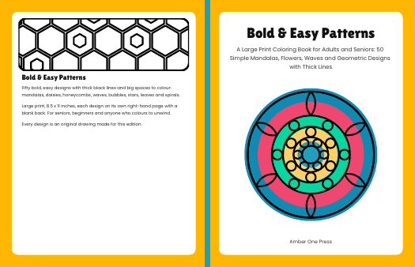
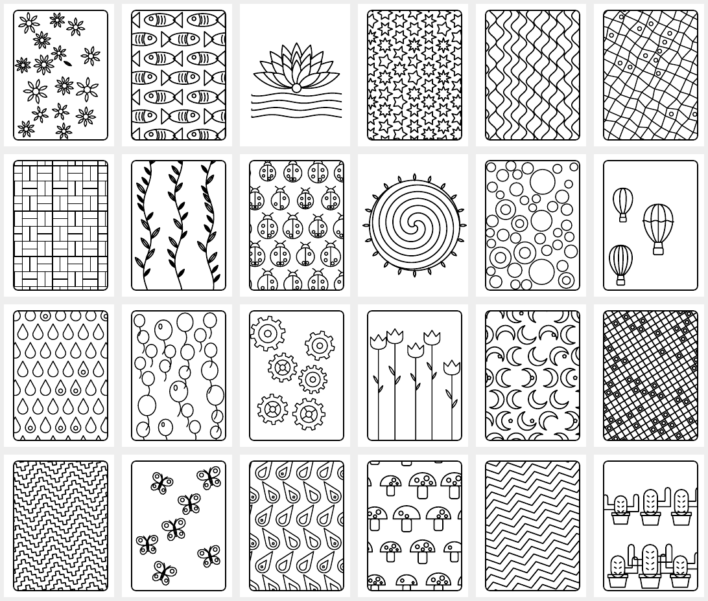
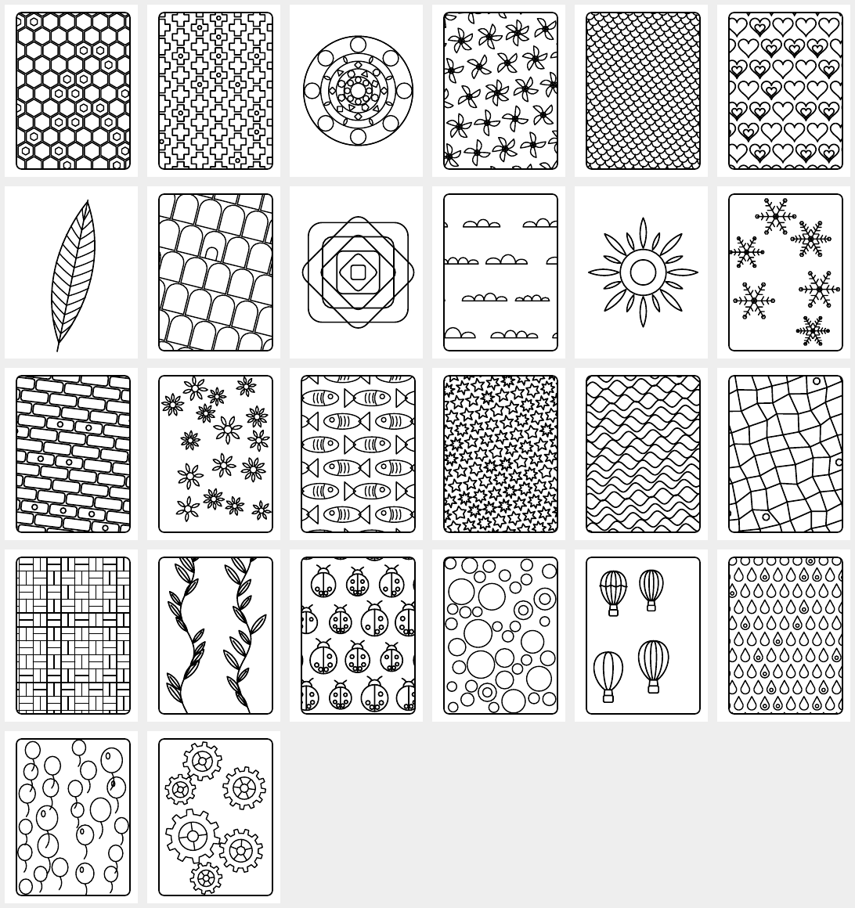

# Report 2 — the pilot book is built and checked; one laptop step stands between it and a KDP draft

Written 2026-10-17 13:5xZ. Follows [REPORT-1](REPORT-1-research-tools-access-cost.md) (market research, tool review, access, cost).

**In one line:** Book 1, *Bold & Easy Patterns* (8.5 × 11 in, 104 pages, 50 single-sided designs from 37 motif families), builds in
2 seconds with every QA check passing, on this machine and on a GitHub runner, byte for byte the same files (section 6). Nothing has
been uploaded to KDP, nothing is published, $0 has been spent and $0 earned. The owner's GO for the draft upload came at 13:5xZ.

## 1. What exists now (evidence)

Local build of 2026-10-17 13:43:49Z (`manifest.builtAt`), book `bold-patterns-01`, seed `20261017`, 1.95 s:

| File | Size | SHA-256 (first 16) |
|---|---|---|
| interior.pdf | 442,956 bytes | `08638da7a6126bce` |
| cover.pdf (full wrap) | 13,910 bytes | `af0d69c46fb88aad` |
| metadata.json, qa.json, manifest.json | — | copied here as `pilot-qa-local-2026-10-17.json`, `pilot-manifest-local-2026-10-17.json` |

QA (poppler + a difference hash, all from the PDFs themselves):

| Check | Result |
|---|---|
| page count | 104 (even, ≥ 24) |
| page size | 612 × 792 pt = 8.5 × 11 in, no bleed |
| fonts embedded | Lilita One, Poppins (both subset, embedded) |
| ink per design page | 4.7 % – 32.4 % (limits 2 – 45 %) |
| near-duplicate designs | closest pair pages 27 and 97, distance 54 of 256 (limit > 10) |
| versos blank | max verso ink 0 |
| cover size | 1258.86 × 810 pt = 17.4842 × 11.25 in, spine 0.2342 in — equals KDP's formula for 104 white pages |

Pricing from KDP's own tables (Report 1): printing $2.84, list $9.99, royalty 60 % → **$3.15 per copy sold**. Nothing has been sold.

Previews (20-dpi thumbnails of every design, and the cover):







## 2. What changed since Report 1 (13:15Z)

1. **CI on amberai #873 was red** (13:23Z): one ratchet test (`web-regex-hazards`, in `test:amber-earnings`) refuses any new file that
   strips HTML with a bare `/<[^>]+>/` regex, and the laptop upload script had one (it turns the listing's own short HTML description
   into plain text for KDP's editor). Replaced with the repository's linear `stripTags()` helper; the failure reproduced locally and the
   same test then passed 37/37; pushed as `940ebf22` at 13:30Z. CI on that head was still running when this was written.
2. **Design variety was the real weakness of the first build.** It drew 10 families five times each; the thumbnails showed five
   near-identical star pages, and the closest pair scored 11 of 256. The builder now has **37 families** (hearts, clouds, chevrons,
   bricks, basket weave, sun, tulips, feather, raindrops, pinwheels, nested squares, butterflies, fish, mushrooms, balloons, gears,
   stepped zigzag, mosaic, arches, snowflakes, moons, ladybugs, cacti, hot-air balloons, lotus, paisley, plus signs, and the ten
   from before). Every family appears once; 13 grid families appear twice with different parameters; a centred motif (mandala,
   spiral, sun, lotus, feather, nested squares) never repeats. Closest pair now 54 of 256. This lives in the working tree and goes
   up as the next pull request once #873 is merged (it only changes files under `kdp/coloring/`).
3. Honest placement against the research: this is a **large-print, bold-and-easy pattern book** — the sub-niche that holds #3
   (*Large Print Easy Color & Frame*) and #6/#8-type titles in Amazon's "Coloring Books for Grown-Ups" list. It is not a cute-character
   book (the #1/#2 *Spooky Cutie* / *Cozy Girl Season* kind); those need illustration, which is the Book 2 decision below.

## 3. The one step only the owner can take (Phase 5: the draft)

The KDP sign-in lives in the laptop's Chromium profile (`.data/browser-automation/profiles/kdp`, created by the 2026-08-28 scripts).
This sandbox has no KDP credential, must not ask for one, and cannot receive a one-time code. So the draft is made on the laptop:

```
cd ~/amberai && git pull                      # after #873 and the follow-up PR are merged
cd kdp/coloring && npm ci
npx tsx src/build.ts --book bold-patterns-01 --seed 20261017 --author "Amber One Press" --out out
cd ../.. && npx tsx scripts/kdp-coloring-draft.ts --dir kdp/coloring/out
```

Needs poppler for the QA step (`brew install poppler` on macOS, `sudo apt-get install poppler-utils` on Debian/Ubuntu). Alternatively
download the artifact of a *KDP coloring book build* workflow run and pass its unzipped folder as `--dir`.

What the script does, in a visible browser: opens KDP in the signed-in profile (if KDP asks you to sign in, do it in that window —
password and code are yours, never in chat), creates a paperback, fills title/subtitle/author/description/keywords/categories, chooses
free KDP ISBN, black ink on white, 8.5 × 11, no bleed, matte, uploads the two PDFs, answers Amazon's AI questions from the facts
(images: **No** — drawn by code, no image generator; text: **Yes** — description and note page drafted by an AI assistant), opens
the KDP previewer and waits for you to approve it, sets $9.99, saves the draft on each page, **never clicks Publish**, screenshots every
step and prints whatever it could not fill. The listing stays a draft until you publish it yourself.

Decisions needed before that run: (a) the author/imprint name (placeholder *Amber One Press*); (b) a read of the description
(`metadata.json`, also printed in the manifest); (c) whether Book 1 is to be the first public title or a draft kept until Book 2.

## 4. Cost and revenue, as they stand

| Item | Amount | Evidence |
|---|---|---|
| Paid services used | $0 | no API key called; pdfkit, poppler and fonts under the SIL Open Font License |
| GitHub Actions | ~2–3 runner minutes per cloud build, on the private repo's included quota | measured once the workflow runs on main |
| Printing cost / royalty at $9.99 | $2.84 / $3.15 per copy | KDP tables cited in Report 1 |
| Book 2 (illustrated, AI images with disclosure) | about $15 per book in image generation | OpenAI list prices in Report 1 — **held for the owner's word** |
| Revenue | $0 | nothing is published; a sale needs a published book and shows in KDP Reports, not in a build log |

## 5. Next, in order

1. #873 green → merge (standing authorization) → one cloud build on `main` → artifact, SHA-256s and runner minutes recorded here.
2. Pull request with the 37 families → merge → rebuild (the seed stays `20261017`, so the book is reproducible).
3. The owner's laptop run (section 3) → the KDP draft → the owner's approval → publish.
4. Phase 6: a `kdp/catalog.json` with one row per book (researched / built / QA / uploaded / published / cost / sales / royalties),
   duplicate prevention by book id and seed, and the sales and royalty reading from KDP Reports inside the signed-in session.

## 6. Verified cloud builds (added 14:0xZ)

amberai #873 went green at 13:52Z (both checks) and was squash-merged as `8be5432c` at 13:53:30Z. The follow-up pull request
[#874](https://github.com/scubamike124/amberai/pull/874) (head `6fd69c69`: the 37 families, centred motifs never repeated,
byte-reproducible PDFs through a fixed creation date) is open with CI running.

Two runs of the *KDP coloring book build* workflow, inputs book `bold-patterns-01`, seed `20261017`, author `Amber One Press`:

| Run | Ref | Job time | Result | Artifact (30-day retention) |
|---|---|---|---|---|
| [39038455158](https://github.com/scubamike124/amberai/actions/runs/39038455158) | `main` @ 8be5432c (the 10-family pilot as merged) | 13:53:58Z → 13:54:44Z (46 s, about 1 billed minute) | QA PASS | `bold-patterns-01-20261017` id 12103301168, 522,328 bytes |
| [39038507273](https://github.com/scubamike124/amberai/actions/runs/39038507273) | `claude/kdp-coloring-patterns` @ 6fd69c69 (the 37-family book) | 13:54:42Z → 13:55:29Z (47 s, about 1 billed minute) | QA PASS | `bold-patterns-01-20261017` id 12103321153, 548,171 bytes, zip digest `110542f3…` |

The runner's *Measure* step printed the same hashes as two independent local builds of the same commit:

| File | SHA-256 (runner, run 39038507273) | Local (two builds, 13:5xZ) |
|---|---|---|
| interior.pdf | `e804d9b40e55c916c5429363bd9f552272ec3e8cedf3e962a97f52ee583c3b4b` | identical |
| cover.pdf | `3126683afcee45bd826a5ea2f1cc92db59bc75588fcbf0eb7db4f543418c077c` | identical |

So whoever builds this commit with these four inputs gets the same two PDFs, and the laptop step (section 3) can be checked against
these hashes before anything is uploaded. The runner's QA line read exactly as the local one (104 pages, 612 × 792 pt, fonts
embedded, ink 4.7–32.4 %, closest pair pages 27/97 at 54 of 256, versos blank, cover 1258.86 × 810 pt). The artifact zip could not be
downloaded into this sandbox (the egress proxy refuses the Azure blob host), which is why the hashes come from the job log; the owner
can download it from the run page.

Imprint: KDP's own ISBN pages (runner read, batch 168, 13:51Z) are quoted in section 7 once extracted. What the search summary says:
with a free KDP ISBN the imprint is fixed to *Independently published*; a brand name as imprint needs your own ISBN. "Amber One Press"
is therefore the contributor (author) name on the listing, which KDP allows as a pen or brand name; the account's earlier e-books
(author "Michael" in the 2026-08-28 script) stay as they are.
